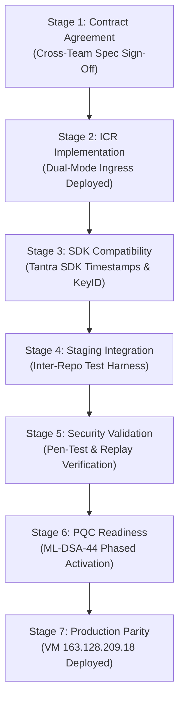

# MIGRATION & ROLLOUT PLAN
## Phased Deployment, Cross-Team Orchestration, and Zero-Downtime Rollout

**Document ID:** ICR-QCG-CRYPTO-ARCH-01-DOC-08  
**Task ID:** ICR-QCG-CRYPTO-ARCH-01  
**Date:** 2026-11-27  
**Author:** Distributed Systems Architect & DevOps Integration Lead  
**Primary Repository:** `Insight-Constitutional-Runtime`  
**Classification:** OPERATIONAL-SPECIFICATION  

---

## 1. Phased Migration Architecture

To achieve zero-downtime integration without requiring a simultaneous, risky "big bang" release across all four independent repositories, the rollout is structured into seven distinct stages:

---

## 2. Seven-Stage Rollout Specification

### Stage 1: Contract Agreement (Status: SPECIFIED)
- **Objective:** Finalize the agreed HTTP header names, canonicalization rules, and algorithm identifiers.
- **Contract Agreement:**
  - Ingress Endpoint: `POST /api/v1/execute`
  - Headers: `X-Service-ID`, `X-Service-KeyID`, `X-Service-Timestamp`, `X-Service-Signature`, `X-Service-PublicKey`, `X-Trust-Level`.
  - Canonicalization: RFC-8785 deterministic JSON (sorted keys, compact separators).
  - Skew Window: $\pm 300\text{ seconds}$. Nonce TTL: 600 seconds.

### Stage 2: ICR Implementation (Status: COMPLETED & VERIFIED)
- **Objective:** Deploy Dual-Mode Ingress and Trusted Key Registry inside ICR.
- **Deliverables:**
  - `src/common/service_auth.py` deployed.
  - `insight_execution_service.py` updated with `verify_dual_mode_auth`.
  - Regression and attack suites passing with 100% success.

### Stage 3: SDK Compatibility Updates (Status: PENDING QCG TEAM)
- **Objective:** QCG team applies proposed changes in `Team-side/bhiv-QCG/sdk_auth.py`.
- **Owner:** Pritesh Patra & Kanishk Singh.
- **Deliverables:**
  - SDK attaches `X-Service-KeyID` and `X-Service-Timestamp`.
  - SDK optionally supports `bearer_token` fallback.

### Stage 4: Controlled Staging Integration (Status: READY TO EXECUTE)
- **Objective:** Execute live HTTP calls between Tantra SDK client and ICR local server.
- **Success Criteria:** HTTP 200 returned with `evidence.trust_method: "CLASSICAL"` and `evidence.status: "SUCCESS"`.

### Stage 5: Security Validation (Status: COMPLETED ON ICR)
- **Objective:** Perform negative security testing across the network boundary.
- **Items:** Replay attacks, public-key substitution, clock-skew exploitation, and unauthorized operation dispatch.

### Stage 6: Post-Quantum Readiness (Status: IMPLEMENTED IN ICR)
- **Objective:** QCG upgrades `PostQuantumTrustProvider` from simulated HMAC to native `mldsa.MLDSA44`.
- **Verification:** Issue ML-DSA-44 signed requests from QCG to ICR gateway; verify `evidence.trust_method: "POST_QUANTUM"`.

### Stage 7: Production VM Deployment (Status: PENDING INFRA TEAM)
- **Objective:** Deploy Canonical ICR Option B (`docker-compose.yml`) to VM host `163.128.209.18`.
- **Owner:** Vijay (Infra Lead).

---

## 3. RACI Ownership Matrix

| Workstream / Deliverable | Ganesh (ICR) | Pritesh (QCG) | Dhiraj (MQR) | QAL Team | Vijay (Infra) |
|:---|:---:|:---:|:---:|:---:|:---:|
| **ICR Dual-Mode Ingress & Key Registry** | **A / R** | C | I | I | I |
| **QCG SDK Timestamp & Auth Headers** | C | **A / R** | I | I | I |
| **QCG Missing Telemetry Routes** | I | **A / R** | I | I | I |
| **MQR Generic vs Pipeline Routing Docs** | I | I | **A / R** | C | I |
| **QAL Blocker Status Correction (MQR-01)**| I | I | C | **A / R** | I |
| **VM 163.128.209.18 Canonical Deployment**| C | I | I | I | **A / R** |

*R = Responsible, A = Accountable, C = Consulted, I = Informed.*

---

## 4. Rollback Procedures & Safeguards

In the event of an unexpected regression or deployment blocker:

1. **ICR Rollback:**
   - Because ICR's Dual-Mode Ingress (`verify_dual_mode_auth`) is strictly additive and non-breaking, rolling back is rarely necessary.
   - If emergency rollback is required:
     `git restore insight_execution_service.py`  
     `rm src/common/service_auth.py tests/test_service_auth_crypto.py`
2. **Circuit Breaker Configuration:**
   - In `platform_capability_sdk.py`, the circuit breaker threshold (`CircuitBreaker`) automatically trips if consecutive failures occur, preventing request cascading into ICR.
3. **Emergency Bearer Fallback:**
   - If an asymmetric key fails, client can supply `Authorization: Bearer <token>` to immediately restore connectivity without code changes.
