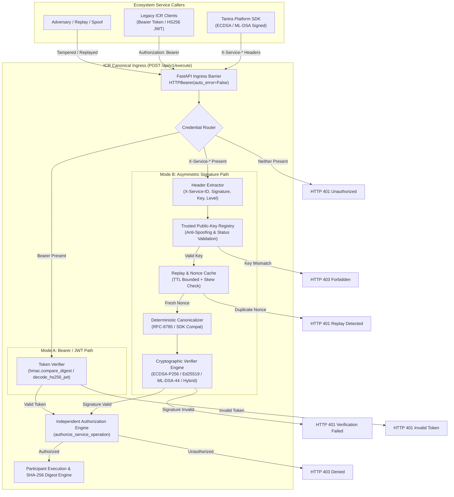

# TARGET TRUST ARCHITECTURE & ZERO-TRUST SPECIFICATION
## Cryptographic Service Identity, Trusted Key Management & Ingress Governance

**Document ID:** ICR-QCG-CRYPTO-ARCH-01-DOC-03  
**Task ID:** ICR-QCG-CRYPTO-ARCH-01  
**Date:** 2026-11-27  
**Author:** Senior Technical Architect & Application Security Engineer  
**Primary Repository:** `Insight-Constitutional-Runtime`  
**Classification:** PROPOSED-DESIGN & AUTHORIZED-IMPLEMENTATION  

---

## 1. Architectural System Overview

The BHIV Target Trust Architecture establishes an authoritative, zero-trust, cryptographically governed boundary at the Insight Constitutional Runtime (ICR) gateway.

---

## 2. Mandatory Architectural Design Answers

As mandated by Section 9.1 of the Master Prompt:

### 1. Who is responsible for issuing service identities?
Service identities (e.g. `insightflow.runtime.intelligence.v1`, `tantra.platform.sdk`) are registered centrally within the governance framework. In ICR, service identities are canonically defined in `src/common/constants.py` (`RUNTIME_IDENTITIES`).

### 2. Who registers public keys?
The ICR **Trusted Public-Key Registry** (`src/common/service_auth.py:TrustedKeyRegistry`) maintains the authoritative binding between service identities and their public keys. In production, keys are provisioned out-of-band via configuration or an authorized registration lifecycle.

### 3. Who is authorized to register or rotate a key?
Only authenticated platform administrators or the owning service holding the previous active key are permitted to register or rotate keys.

### 4. How does ICR resolve a service identity?
ICR reads the `X-Service-ID` header and optional `X-Service-KeyID`. It looks up the associated `TrustedKeyRecord` in `TrustedKeyRegistry`.

### 5. How does ICR identify the signing algorithm?
The algorithm is determined by the registered `TrustedKeyRecord.algorithm` associated with the verified key. In dynamic/onboarding mode, it is inferred from `X-Trust-Level` (`CLASSICAL` $\rightarrow$ `ECDSA-P256`, `POST_QUANTUM` $\rightarrow$ `ML-DSA-44`, `HYBRID` $\rightarrow$ `HYBRID-ECDSA-MLDSA`).

### 6. How does ICR identify a key version?
Via the `X-Service-KeyID` header (defaulting to `"default"` or `"k-v1"`).

### 7. How is the request signature generated?
The client signs the canonical bytes of the request payload using its private key:
`sig = private_key.sign(canonical_bytes)`.

### 8. What exact request content is signed?
In the initial compatible phase, the JSON payload dictionary is signed:
`payload_bytes = json.dumps(payload, sort_keys=True, default=str).encode('utf-8')`.
In the target Phase 2 standard, the method, path, and content digest are bound:
`SHA-256(POST || /api/v1/execute || SHA-256(body))`.

### 9. How are timestamps validated?
If `X-Service-Timestamp` is provided, ICR parses it and enforces $|t_{server} - t_{client}| \le \Delta_{max}$ where $\Delta_{max} = 300\text{ seconds}$ (5 minutes).

### 10. How are nonces stored and checked?
Nonces (the request's `invocation_id` or signature prefix) are tracked in `ReplayProtectionCache` with a 600-second TTL. Duplicate nonces within the TTL are rejected immediately with HTTP 401.

### 11. How are replay attacks prevented across multiple ICR instances?
In single-instance deployments, the in-memory cache enforces non-replay. In distributed deployments, the cache interface delegates to an atomic Redis `SET ... NX EX 600` key store.

### 12. How are expired keys handled?
`TrustedKeyRecord.is_valid()` checks `time.time() > expires_at`. If expired, requests are rejected with HTTP 403 Forbidden.

### 13. How are revoked keys handled?
Keys with `status == "REVOKED"` are rejected with HTTP 403 Forbidden immediately upon lookup.

### 14. How is authorization enforced after authentication?
Authentication produces an `AuthenticatedPrincipal`. The authorization module (`authorize_service_operation()`) checks the principal against the requested target service and operation, completely independent of `X-Trust-Level`.

### 15. How is algorithm downgrade prevented?
A service registered with `ML-DSA-44` or `HYBRID` cannot authenticate using `ECDSA-P256`. The verifier strictly enforces the algorithm specified in the service's trusted registry record.

### 16. How are failed authentication attempts audited?
Every authentication failure logs a structured security event containing `caller_service`, `reason`, `client_ip`, `key_id`, and `timestamp`.

### 17. How are signing keys protected?
Private keys reside solely within client keystores or HSMs. ICR never handles or stores client private keys.

### 18. How does the design support post-quantum migration?
The `verify_cryptographic_signature()` engine is algorithm-agile, supporting NIST FIPS 204 `ML-DSA-44`, `ML-DSA-65`, and hybrid composite signatures natively.

---

## 3. Threat Model & Security Mitigations

| Threat Vector | Attack Scenario | Architectural Mitigation in ICR | Test Evidence |
|:---|:---|:---|:---:|
| **Public-Key Substitution / Identity Spoofing** | Attacker generates ephemeral keypair, sets `X-Service-ID: insightflow.v1`, signs malicious payload with their private key, attaches public key in `X-Service-PublicKey`. | `TrustedKeyRegistry` strictly verifies that `presented_pubkey == trusted_record.public_key`. Unregistered keys are rejected with HTTP 403. | `test_public_key_substitution_attack_rejection` (PASSED) |
| **Replay Attack** | Attacker intercepts valid signed request on network and replays it 1,000 times. | `ReplayProtectionCache` tracks `invocation_id`. Duplicate nonce within TTL window is rejected with HTTP 401. | `test_replay_protection_duplicate_nonce` (PASSED) |
| **Payload Tampering** | Attacker intercepts request and modifies `{"test": true}` to `{"test": false}`. | Signature verification fails against canonical body. Rejected with HTTP 401. | `test_ecdsa_p256_verification` (PASSED) |
| **Clock-Skew Attack** | Attacker re-submits old captured request hours later. | `ReplayProtectionCache` enforces $\pm 300\text{s}$ tolerance window. Stale timestamps rejected with HTTP 401. | `test_timestamp_clock_skew_tolerance` (PASSED) |
| **Algorithm Downgrade Attack** | Attacker strips post-quantum signature and claims classical ECDSA for a quantum service. | Key registry specifies required algorithm for each service identity. Downgrade attempts fail closed. | `test_unsupported_algorithm_fails_closed` (PASSED) |
| **Privilege Escalation** | Untrusted caller sets `X-Trust-Level: QUANTUM` hoping to gain administrative privileges. | `authorize_service_operation()` decouples trust level from permissions. Operations strictly governed by registry whitelist. | `test_authorization_separation` (PASSED) |
